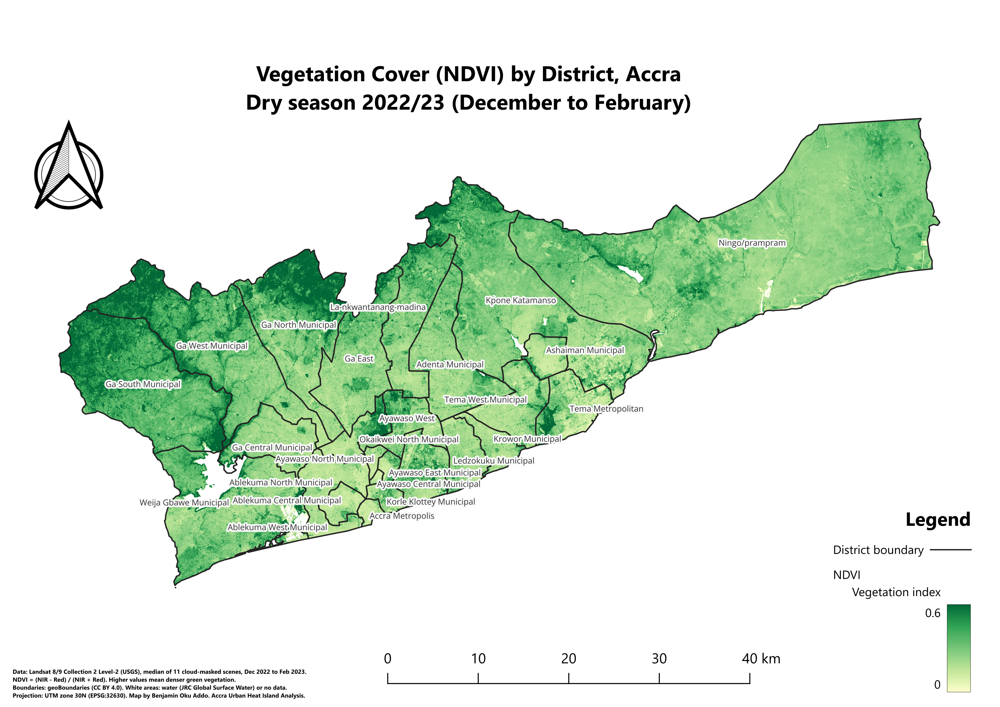
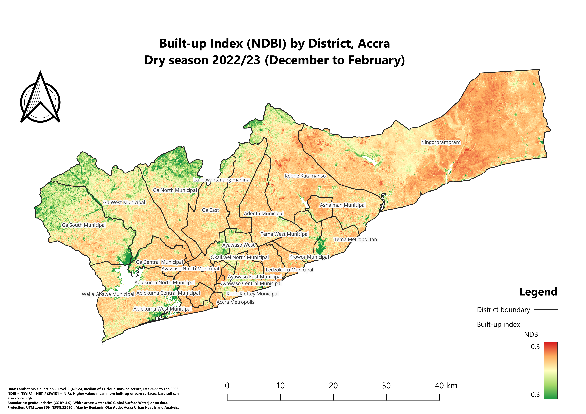

# Accra Urban Heat Island Analysis

Mapping land surface temperature, vegetation and built-up surfaces across Greater Accra, Ghana, using Landsat 8/9 imagery, Google Earth Engine and Python.

**[View the interactive heat map](https://benjaminokuaddo34.github.io/Accra-Urban-Heat-Island-Analysis/maps/interactive/accra_heat_map.html)**


## Contents

1. [Overview](#1-overview)
2. [Key findings](#2-key-findings)
3. [Maps](#3-maps)
4. [Data and methods](#4-data-and-methods)
5. [Results tables](#5-results-tables)
6. [Limitations](#6-limitations)
7. [Repository structure](#7-repository-structure)
8. [How to reproduce](#8-how-to-reproduce)
9. [Project status](#9-project-status)
10. [Data credits and license](#10-data-credits-and-license)

## 1. Overview

**Category:** Remote sensing, environmental analysis, GIS
**Study area:** 26 districts of the Greater Accra Region, Ghana
**Period:** five dry seasons, 2019/20 to 2023/24 (December to February)
**Tools:** Google Earth Engine, Python, Geemap, GeoPandas, Folium, QGIS

### Question

Which parts of Accra have the hottest surfaces, how consistent is that pattern from year to year, and how much of it is explained by vegetation and built-up or bare surfaces?

### What this project does

- Retrieves Landsat 8 and 9 Collection 2 Level-2 imagery and removes clouds, cloud shadow and cirrus.
- Calculates land surface temperature (LST) in °C, plus NDVI (vegetation) and NDBI (built-up and bare surfaces).
- Measures how LST relates to NDVI and NDBI.
- Ranks 26 districts by heat and checks whether the ranking is stable across five seasons.
- Publishes an interactive web map and static cartographic maps.

## 2. Key findings

- **Vegetation and heat are strongly linked.** In the 2022/23 dry season, LST had a correlation of **-0.78 with NDVI** and **+0.74 with NDBI** across 1,022 sampled land pixels.
- **Consistent hotspots.** Ashaiman, Ablekuma Central, Ablekuma West, Ayawaso Central and Accra Metropolis were hotter than the city average in all five seasons.
- **Consistent cool zones.** Ga North ranked coolest of the 26 districts in every season. Ga West, Ga South and La-Nkwantanang-Madina were also near the bottom every year.
- **Size of the gap.** The hottest districts average about 6 °C above the coolest after the season-wide shift is removed.
- **Not every district is stable.** Tema Metropolitan ranged from 4th to 14th and Accra Metropolis from 1st to 10th, so their exact positions should be read with care.
- **Surface type matters beyond NDVI and NDBI.** Tema Metropolitan ranks among the hottest despite a low NDBI, which may reflect port and industrial surfaces that the index does not capture well. This is an interpretation that has not been tested.

## 3. Maps

### Interactive map

**[Open the interactive map](https://benjaminokuaddo34.github.io/Accra-Urban-Heat-Island-Analysis/maps/interactive/accra_heat_map.html)**

- Hover over any district for its surface temperature, its difference from the city average, and its rank.
- Switch between the five dry seasons and the five-season average.
- Turn on the pixel-level heat layer for 2022/23.
- Switch between a light grey basemap and satellite imagery.

### Static maps, dry season 2022/23

**Land surface temperature**


**Vegetation (NDVI)**



**Built-up index (NDBI)**



NDBI picks up dry bare soil as well as buildings, so in the dry season it separates vegetated from non-vegetated land better than it separates the city from bare land. NDVI gives the cleaner explanation of the heat pattern.

## 4. Data and methods

### Data

| Dataset | Use |
|---|---|
| Landsat 8 Collection 2 Level-2 (USGS) | Surface temperature and surface reflectance |
| Landsat 9 Collection 2 Level-2 (USGS) | Surface temperature and surface reflectance |
| geoBoundaries ADM2 v6.0.0 | District boundaries (CC BY 4.0) |
| JRC Global Surface Water | Water mask |

All imagery is accessed and processed through Google Earth Engine.

### Scene availability

Accra's rainy seasons produce heavy cloud cover. Between June and October very few usable scenes exist, and September is almost empty, so the analysis uses the dry season (December to February).

| Season | Scenes used |
|---|---|
| 2019/20 | 6 |
| 2020/21 | 6 |
| 2021/22 | 9 |
| 2022/23 | 11 |
| 2023/24 | 11 |

### Processing steps

1. **Select scenes.** Landsat 8 and 9 over the study area, filtered by date and by scene cloud cover (below 70%).
2. **Mask clouds.** Cloud, dilated cloud, cirrus and cloud shadow pixels are removed using the `QA_PIXEL` band.
3. **Calculate LST.** The `ST_B10` band is scaled (0.00341802 + 149.0) and converted from Kelvin to °C.
4. **Calculate indices.** Reflectance bands are scaled, then NDVI = (NIR - Red) / (NIR + Red) and NDBI = (SWIR1 - NIR) / (SWIR1 + NIR).
5. **Combine scenes.** The per-pixel median across the season's scenes gives one image per season.
6. **Mask water.** Pixels that are water more than 50% of the time are removed, so lagoons and sea do not cool district averages.
7. **Summarise by district.** Mean LST, NDVI and NDBI are calculated for each of the 26 districts at 120 m.
8. **Compare seasons.** Each district's LST is compared with the city average for that season (an anomaly), and ranked.
9. **Test relationships.** Correlations between LST, NDVI and NDBI are calculated on a random sample of land pixels.
10. **Publish.** Results are joined to the district shapes and exported as an interactive Folium map. Full-resolution rasters are exported at 30 m for QGIS cartography.

### Why anomalies instead of raw temperatures

Absolute temperatures differ a lot between seasons, mainly because of which dates were clear, how many scenes were available, and the weather. District averages jumped by several °C between 2020/21 and 2021/22 for almost every district. Comparing each district with the city average removes that shared shift, so the ranking reflects differences between districts and not between years. The city average used here is a simple unweighted average across the 26 districts.

## 5. Results tables

| File | Contents |
|---|---|
| [`reports/district_ranking_dry_2022_23.csv`](reports/district_ranking_dry_2022_23.csv) | District mean LST, NDVI, NDBI and pixel counts for 2022/23 |
| [`reports/district_ranking_all_seasons.csv`](reports/district_ranking_all_seasons.csv) | The same measures for all five seasons, with scene counts |
| [`reports/district_anomaly_by_season.csv`](reports/district_anomaly_by_season.csv) | Each district's heat relative to the city average, by season |

### Notebooks

| Notebook | Contents |
|---|---|
| [`01_data_exploration.ipynb`](notebooks/01_data_exploration.ipynb) | Earth Engine setup, Landsat availability by month, cloud masking |
| [`02_landsat_preprocessing.ipynb`](notebooks/02_landsat_preprocessing.ipynb) | LST, NDVI and NDBI, correlation analysis, district ranking, multi-season comparison, interactive map |

## 6. Limitations

- **Surface temperature is not air temperature.** LST describes how hot the ground and roofs are, which can be much higher than air temperature on a sunny day.
- **Dry season only.** The rainy season has too few cloud-free scenes for a reliable comparison, so wet-versus-dry patterns are not analysed.
- **Small scene counts.** Two seasons rest on six scenes each, so one or two unusual days can influence the median.
- **Seasons are not directly comparable in degrees.** This is why the analysis uses anomalies relative to the city average. No warming trend is claimed.
- **Harmattan dust haze.** The cloud mask does not remove dust haze, which may slightly affect temperature and index values.
- **District averages hide detail.** Averages were calculated at 120 m. Large rural districts (such as Ningo/Prampram and Kpone Katamanso) and small central districts should be read differently, and very small districts have noisier averages.
- **NDBI responds to bare soil.** A high NDBI does not always mean buildings.
- **NDVI and NDBI overlap.** They are correlated at about -0.91, so their separate effects on temperature cannot be reliably separated.
- **Correlation is not proof of cause.** Distance from the sea, elevation, soil moisture and surface materials also influence temperature.
- **Correlation sample.** Correlations come from a sample of 1,022 land pixels at 200 m for one season (2022/23).

## 7. Repository structure

```text
Accra-Urban-Heat-Island-Analysis/
│
├── data/                      # Not tracked by Git (large rasters, local outputs)
│   ├── raw/
│   ├── interim/
│   ├── processed/
│   └── external/
│
├── docs/
│   └── 01_setup_log.md        # Setup and progress log
│
├── maps/
│   ├── static/                # QGIS maps (LST, NDVI, NDBI)
│   └── interactive/           # Folium map and pixel-level layer
│
├── notebooks/
│   ├── 01_data_exploration.ipynb
│   └── 02_landsat_preprocessing.ipynb
│
├── qgis/
│   └── accra_heat_analysis.qgz
│
├── reports/
│   └── *.csv                  # District results tables
│
├── .env.example
├── .gitignore
├── .dockerignore
├── compose.yaml
├── requirements.txt
├── LICENSE
└── README.md
```

## 8. How to reproduce

1. **Clone the repository** and create a Python environment:

   ```powershell
   python -m venv .venv
   .venv\Scripts\Activate.ps1
   pip install -r requirements.txt
   ```

2. **Register for Google Earth Engine** (non-commercial use) and create a Google Cloud project.
3. **Authenticate:**

   ```powershell
   python -c "import ee; ee.Authenticate()"
   ```

4. **Set your project ID.** Copy `.env.example` to `.env` and set:

   ```
   EE_PROJECT=your-gcp-project-id
   ```

5. **Run the notebooks in order** (`01`, then `02`).

Large rasters are not stored in the repository. Notebook 02 exports the three-band GeoTIFF (LST, NDVI, NDBI) to Google Drive. Place it in `data/processed/` to use it in QGIS, otherwise the QGIS project layers will show as broken. Credentials and your `.env` file are never committed.

## 9. Project status

**Current stage:** district-level and pixel-level analysis, interactive map and static maps are complete.

| Item | Status |
|---|---|
| Cloud masking, LST, NDVI, NDBI | Complete |
| District ranking across five dry seasons | Complete |
| Interactive web map | Complete |
| Static maps (QGIS) | Complete for 2022/23 |
| Written report | Planned |
| Docker environment | Planned |
| Reusable code in `src/` | Planned |

## 10. Data credits and license

**Data**

- Landsat 8 and 9 Collection 2 Level-2 imagery: U.S. Geological Survey, accessed through Google Earth Engine.
- District boundaries: geoBoundaries, version 6.0.0 (CC BY 4.0).
- Surface water: JRC Global Surface Water.
- Basemap tiles in the interactive map: Esri.

**Software:** Google Earth Engine, Python, Geemap, GeoPandas, Folium, QGIS.

**License:** this project is published under the MIT License (see [`LICENSE`](LICENSE)). External datasets keep their own licenses.

**Author:** Benjamin Oku Addo
