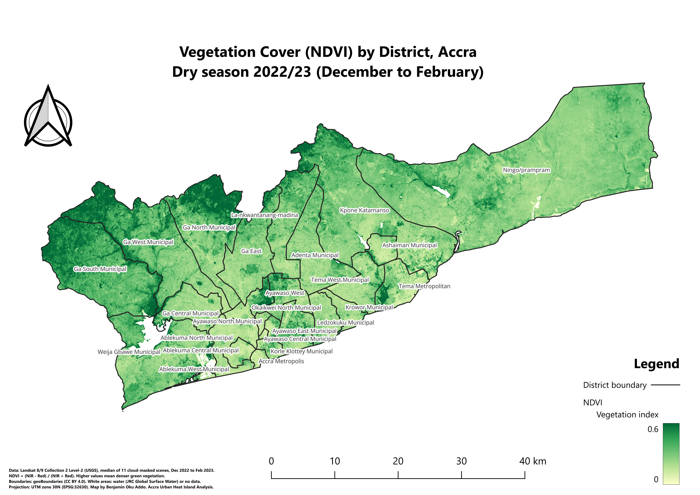
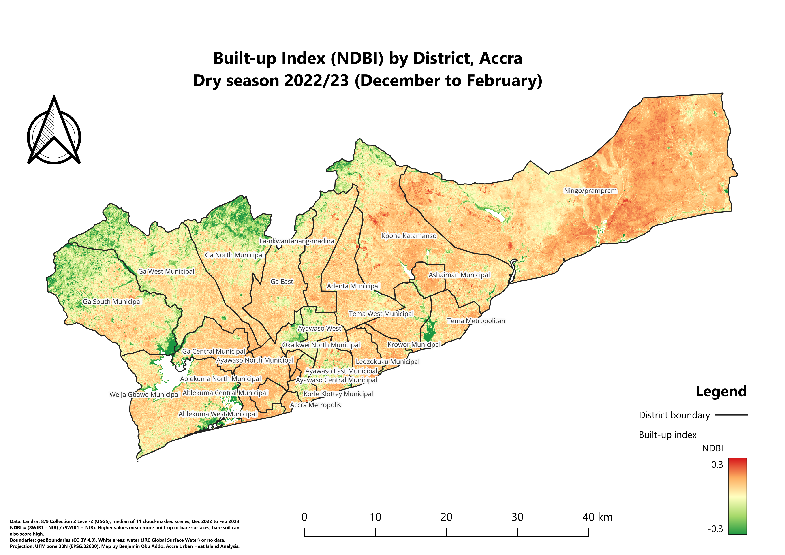

# Urban Heat in Greater Accra: Land Surface Temperature, Vegetation and Built-up Surfaces, 2019 to 2024

**Author:** Benjamin Oku Addo
**Date:** November 2026
**Repository:** [Accra-Urban-Heat-Island-Analysis](https://github.com/BenjaminOkuAddo34/Accra-Urban-Heat-Island-Analysis)
**Interactive map:** [Open the map](https://benjaminokuaddo34.github.io/Accra-Urban-Heat-Island-Analysis/maps/interactive/accra_heat_map.html)

## Summary

This report maps land surface temperature (LST) across 26 districts of the Greater Accra Region, Ghana, using Landsat 8 and 9 satellite imagery processed in Google Earth Engine. It examines how surface temperature relates to vegetation (NDVI) and to built-up or bare surfaces (NDBI), and it ranks districts by heat across five dry seasons from 2019/20 to 2023/24.

The main findings are:

1. **Heat follows vegetation.** In the 2022/23 dry season, LST had a correlation of -0.78 with NDVI and +0.74 with NDBI across 1,022 sampled land pixels.
2. **A stable heat pattern exists.** Ashaiman, Ablekuma Central, Ablekuma West, Ayawaso Central and Accra Metropolis were hotter than the city average in all five seasons, as was Ningo/Prampram. Ga North ranked coolest in every season, with Ga West, Ga South and La-Nkwantanang-Madina also consistently near the bottom.
3. **The gap is large.** After removing the season-wide shift, the hottest districts averaged roughly 2 °C above the city average and the coolest about 3 to 4 °C below it, a spread of about 6 °C.
4. **Some districts do not fit a simple story.** Tema Metropolitan ranks among the hottest despite a low NDBI, and rank positions for several districts change between seasons.

The results describe surface temperature in the dry season only. They do not establish causes, and they do not show a warming trend.

## 1. Introduction

Cities are often warmer than their surroundings because buildings, roads and bare ground absorb and store heat, while vegetation cools through shade and evaporation. In a fast-growing city such as Accra, knowing which districts run hottest, and whether that pattern is persistent, helps frame discussions about tree planting, green space and heat exposure.

Satellites offer a consistent way to measure this across a whole city. Landsat 8 and 9 carry thermal sensors that estimate the temperature of the ground surface at 30 m resolution, and their optical bands allow vegetation and built-up indices to be calculated from the same images.

### Questions

1. Which parts of Greater Accra have the hottest surfaces in the dry season?
2. How strongly is surface temperature related to vegetation and to built-up or bare surfaces?
3. Is the district heat ranking stable from one dry season to the next?

## 2. Study area

The study area is the 26 districts of the Greater Accra Region that were identified from the geoBoundaries ADM2 dataset (version 6.0.0). The area includes the dense coastal core (for example Accra Metropolis, Korle Klottey and Ablekuma), the industrial and port area around Tema and Ashaiman, and large, mostly rural districts to the north, west and east (Ga North, Ga West, Ga South, Kpone Katamanso and Ningo/Prampram).

Two Eastern Region districts (Akwapem South and Nsawam Adoagyiri) touched the initial rough study box and were removed, because they are not part of Greater Accra.

## 3. Data

| Dataset | Source | Use |
|---|---|---|
| Landsat 8 Collection 2 Level-2 | USGS, via Google Earth Engine | Surface temperature and reflectance |
| Landsat 9 Collection 2 Level-2 | USGS, via Google Earth Engine | Surface temperature and reflectance |
| geoBoundaries ADM2 v6.0.0 | geoBoundaries (CC BY 4.0) | District boundaries |
| JRC Global Surface Water | European Commission Joint Research Centre | Water mask |

### Choice of season

Accra has two rainy seasons, and cloud cover is heavy for much of the year. Between 2019 and 2024, using a scene cloud limit of 70%, the months from June to October produced only zero to three usable scenes each, and September was almost empty in most years. The months from November to March were far better covered. The analysis therefore uses the dry season, December to February.

| Season | Scenes used |
|---|---|
| 2019/20 | 6 |
| 2020/21 | 6 |
| 2021/22 | 9 |
| 2022/23 | 11 |
| 2023/24 | 11 |

Landsat 9 launched in September 2021, so the first two seasons (2019/20 and 2020/21) rely on Landsat 8 alone, which helps explain their lower scene counts.

## 4. Methods

### 4.1 Cloud masking

For each scene, the `QA_PIXEL` quality band was used to remove pixels flagged as cloud, dilated cloud, cirrus or cloud shadow. Scenes with more than 70% cloud cover over the whole Landsat tile were excluded first. The scene-level figure refers to a tile much larger than Accra, so it only roughly indicates conditions over the city, and pixel-level masking was used for the detailed work.

The mask does not remove harmattan dust haze, which is common in the dry season.

### 4.2 Land surface temperature

The Level-2 surface temperature band (`ST_B10`) was converted to degrees Celsius using the standard Collection 2 scaling (multiply by 0.00341802, add 149.0 to obtain Kelvin, then subtract 273.15).

### 4.3 Vegetation and built-up indices

Surface reflectance bands were scaled (multiply by 0.0000275, subtract 0.2) and used to calculate:

- **NDVI** = (NIR - Red) / (NIR + Red), where high values indicate dense green vegetation.
- **NDBI** = (SWIR1 - NIR) / (SWIR1 + NIR), where high values indicate built-up or bare surfaces.

### 4.4 Seasonal composites and water mask

For each season, the per-pixel median across all usable scenes produced one image each for LST, NDVI and NDBI. The median reduces the influence of single unusual days and residual cloud. Pixels that are water more than 50% of the time (JRC Global Surface Water, occurrence above 50) were removed, so lagoons and the sea do not lower district averages.

### 4.5 Relationship between LST, NDVI and NDBI

For the 2022/23 season, a random sample of land pixels was drawn at 200 m resolution. After removing missing values, 1,022 pixels remained, and Pearson correlations were calculated between LST, NDVI and NDBI.

### 4.6 District summaries and ranking

For each season, the mean LST, NDVI and NDBI were calculated inside each of the 26 districts at 120 m resolution. Because absolute temperatures differ between seasons (see section 5.4), each district's mean LST was compared with that season's city average, calculated as the simple, unweighted mean across the 26 districts. The difference is called the heat anomaly. Districts were also ranked in each season (1 = hottest), and each district's best, worst and average rank across the five seasons were recorded.

### 4.7 Mapping

Results were joined to the district shapes and published as an interactive web map (Folium), including a pixel-level LST layer for 2022/23. Static maps of LST, NDVI and NDBI for 2022/23 were produced in QGIS from a 30 m, three-band GeoTIFF in UTM zone 30N (EPSG:32630).

## 5. Results

### 5.1 Surface temperature, 2022/23

Over the original rough study box, the 2022/23 LST composite had a median of 36.2 °C, a 5th percentile of 27.4 °C and a 95th percentile of 41.7 °C, with extremes of 26.4 °C and 51.3 °C. These are surface temperatures, which are typically higher than air temperatures on sunny days.

The static map shows a clear pattern:

- The hottest surfaces are along the coast from Accra Metropolis eastwards to Tema and Ashaiman, and across the large eastern district of Ningo/Prampram.
- The coolest surfaces are in the north-west, in Ga North, Ga West and Ga South.

### 5.2 Vegetation and built-up surfaces

NDVI is highest in the north-west, in the same districts where LST is lowest, and lowest in the dense coastal core.

NDBI is high across much of the area, including the rural east. This is because dry bare soil also scores high on NDBI, so in the dry season the index separates vegetated from non-vegetated land better than it separates city from bare land.

**Correlations across 1,022 sampled land pixels (2022/23):**

| Pair | Correlation |
|---|---|
| LST and NDVI | -0.78 |
| LST and NDBI | +0.74 |
| NDVI and NDBI | -0.91 |

Both relationships are strong and in the expected direction: pixels with more vegetation tend to be cooler, and pixels with more built-up or bare surface tend to be hotter. NDVI and NDBI are strongly negatively correlated with each other, so they largely carry the same information from opposite sides, and their separate effects cannot be reliably separated here.

### 5.3 District results, 2022/23

| Rank | District | Mean LST (°C) | NDVI | NDBI | Pixels (120 m) |
|---|---|---|---|---|---|
| 1 | Accra Metropolis | 41.90 | 0.16 | 0.10 | 422 |
| 2 | Ningo/Prampram | 41.18 | 0.28 | 0.10 | 43,538 |
| 3 | Ablekuma West | 40.95 | 0.20 | 0.11 | 939 |
| 4 | Ayawaso Central | 40.80 | 0.15 | 0.12 | 138 |
| 5 | Tema Metropolitan | 40.78 | 0.27 | 0.03 | 3,052 |
| 6 | Krowor | 40.71 | 0.22 | 0.09 | 1,372 |
| 7 | Ashaiman | 40.50 | 0.22 | 0.09 | 1,368 |
| 8 | Ablekuma Central | 40.28 | 0.18 | 0.11 | 1,068 |
| 9 | Tema West | 40.07 | 0.24 | 0.06 | 3,326 |
| 10 | Ledzokuku | 39.92 | 0.23 | 0.09 | 2,136 |
| 11 | Korle Klottey | 39.42 | 0.26 | 0.04 | 734 |
| 12 | La Dade-Kotopon | 38.96 | 0.29 | 0.04 | 2,605 |
| 13 | Kpone Katamanso | 38.49 | 0.31 | 0.06 | 17,144 |
| 14 | Ablekuma North | 38.33 | 0.18 | 0.10 | 2,202 |
| 15 | Ayawaso East | 38.27 | 0.26 | 0.04 | 488 |
| 16 | Ayawaso North | 38.17 | 0.19 | 0.09 | 405 |
| 17 | Adenta | 38.03 | 0.26 | 0.06 | 5,692 |
| 18 | Ga Central | 37.50 | 0.25 | 0.07 | 3,503 |
| 19 | Ga East | 37.06 | 0.29 | 0.05 | 6,304 |
| 20 | La-Nkwantanang-Madina | 36.95 | 0.31 | 0.05 | 5,237 |
| 21 | Ayawaso West | 36.85 | 0.30 | 0.01 | 2,471 |
| 22 | Weija Gbawe | 36.57 | 0.31 | 0.03 | 9,745 |
| 23 | Okaikwei North | 35.99 | 0.33 | 0.00 | 1,723 |
| 24 | Ga West | 34.92 | 0.41 | -0.01 | 12,743 |
| 25 | Ga South | 34.68 | 0.45 | -0.03 | 12,797 |
| 26 | Ga North | 34.56 | 0.42 | -0.03 | 9,090 |

The hottest central districts (Accra Metropolis, Ayawaso Central, Ablekuma West and Ablekuma Central) have low NDVI (0.15 to 0.20) and the highest NDBI values (0.10 to 0.12). The coolest districts (Ga West, Ga South and Ga North) have the highest NDVI (0.41 to 0.45) and slightly negative NDBI. Pixel counts differ greatly: districts with a few hundred pixels (such as Ayawaso Central, with 138) have noisier averages than large districts.

### 5.4 Comparing five dry seasons

Mean district temperatures were not comparable across seasons. For almost every district, the average rose by several degrees in 2020/21 and fell in 2021/22. For example, Accra Metropolis averaged 40.2, 43.4, 39.2, 41.9 and 40.2 °C across the five seasons, and Ga North averaged 35.5, 36.4, 34.6, 34.6 and 36.0 °C. A shift this large and this uniform is more likely to reflect which dates were clear, the number of scenes (six in each of the first two seasons) and weather than a real change in the city. The data do not allow conclusions about a warming or cooling trend, so seasons were compared using heat anomalies and ranks.

### 5.5 Heat anomalies and rank stability

| District | Average anomaly (°C) | Average rank | Best rank | Worst rank |
|---|---|---|---|---|
| Ningo/Prampram | +1.92 | 3.8 | 1 | 13 |
| Ashaiman | +1.88 | 3.4 | 1 | 7 |
| Ablekuma Central | +1.74 | 4.2 | 2 | 8 |
| Accra Metropolis | +1.72 | 5.6 | 1 | 10 |
| Ayawaso Central | +1.70 | 5.0 | 1 | 8 |
| Ablekuma West | +1.66 | 4.8 | 3 | 10 |
| Krowor | +1.36 | 6.6 | 3 | 11 |
| Tema Metropolitan | +1.32 | 7.8 | 4 | 14 |
| Tema West | +1.06 | 9.0 | 5 | 11 |
| Ledzokuku | +1.00 | 9.4 | 6 | 12 |
| Ablekuma North | +0.98 | 8.2 | 5 | 14 |
| Ayawaso North | +0.60 | 11.0 | 8 | 16 |
| La Dade-Kotopon | +0.26 | 13.2 | 12 | 14 |
| Korle Klottey | +0.24 | 13.6 | 10 | 17 |
| Ayawaso East | -0.02 | 15.2 | 12 | 18 |
| Adenta | -0.24 | 16.4 | 16 | 17 |
| Ga Central | -0.42 | 16.6 | 13 | 19 |
| Kpone Katamanso | -0.54 | 16.8 | 13 | 21 |
| Weija Gbawe | -0.84 | 19.0 | 16 | 22 |
| Ayawaso West | -0.92 | 19.8 | 15 | 22 |
| Okaikwei North | -1.24 | 20.4 | 18 | 23 |
| Ga East | -1.48 | 21.0 | 19 | 23 |
| La-Nkwantanang-Madina | -2.14 | 22.8 | 20 | 25 |
| Ga West | -2.90 | 24.2 | 24 | 25 |
| Ga South | -2.92 | 24.0 | 22 | 25 |
| Ga North | -3.84 | 26.0 | 26 | 26 |

Key points from the table:

- **A persistent hot group.** Ashaiman, Ablekuma Central, Accra Metropolis, Ayawaso Central, Ablekuma West and Ningo/Prampram are each hotter than the city average in all five seasons (average anomaly between about +1.7 and +1.9 °C).
- **A persistent cool group.** Ga North ranked 26th in every season. Ga West ranked 24th or 25th in every season, Ga South ranked between 22nd and 25th, and La-Nkwantanang-Madina between 20th and 25th.
- **A middle group changes position.** Tema Metropolitan (4th to 14th), Accra Metropolis (1st to 10th), Ablekuma North (5th to 14th) and Ningo/Prampram (1st to 13th) show wide rank ranges, so their exact positions should not be over-interpreted.
- **The gap between groups is about 6 °C** (from +1.9 °C in the hottest to -3.8 °C in the coolest).

The interactive map allows these results to be explored by season, and a pixel-level layer shows temperature differences within districts.

## 6. Discussion

### 6.1 Vegetation and surface heat

The strong negative correlation between LST and NDVI, and the maps themselves, fit the expected role of vegetation in cooling surfaces. The coolest districts are the greenest, and the hottest central districts have the least vegetation. The positive correlation with NDBI is consistent with hard surfaces and bare ground being hotter. Correlation alone does not prove that vegetation or buildings cause the differences. Distance from the sea, elevation, soil moisture and surface materials also differ across the area.

### 6.2 What NDBI does and does not show

NDBI is high across large parts of the rural east in the dry season, at levels similar to some central districts. Dry bare soil and dry grass reflect similarly to buildings in the shortwave infrared bands, so NDBI should not be read as a map of buildings here. NDVI gave the clearer explanation of the heat pattern. A land-cover classification or building footprint data would be needed to separate built-up land from bare soil.

### 6.3 Large rural districts

Ningo/Prampram ranks among the hottest districts in every season despite being largely rural. Its NDVI is mid-range (0.28) and its NDBI is as high as in the city centre. One plausible explanation is that dry grassland and bare ground heat up strongly in the dry season. This explanation has not been tested, and the finding should be read as "hot surface" rather than "dense urban heat". The district covers around 620 km², so its average blends very different land types. Kpone Katamanso is similar in size and character.

### 6.4 Tema Metropolitan

Tema Metropolitan has among the hottest surfaces but a low NDBI (0.03) and moderate NDVI (0.27). One possible explanation is that the port and industrial areas include metal roofs, concrete and paved surfaces that NDBI does not capture well. This has not been tested. It could be checked using high-resolution imagery or land-use data.

### 6.5 Why a stable ranking is more useful than raw temperatures

Raw district temperatures moved by several degrees between seasons, in the same direction for almost every district. Comparing each district with the city average removes that shared movement and leaves the relative pattern, which was far more consistent. The comparison depends on the simple city average used, which gives each district equal weight regardless of size, so large rural districts count as much as small central ones.

## 7. Limitations

- **Surface temperature is not air temperature.** LST describes how hot the ground and roofs are, which can be much higher than air temperature, and it is not a direct measure of heat exposure for people.
- **Dry season only.** The rainy season has too few cloud-free scenes for a reliable analysis, so wet-versus-dry differences are not examined.
- **Small scene counts.** Two seasons rest on six scenes each, and a few unusual days can influence a median.
- **No trend analysis.** Seasonal differences in absolute temperature cannot be separated from differences in dates, scene counts and weather, so no warming trend is claimed.
- **Harmattan dust haze.** The cloud mask does not remove haze, which may slightly affect temperature and index values.
- **District averages hide detail.** Averages were calculated at 120 m. Large districts mix very different surfaces, and districts with few pixels (for example Ayawaso Central, with 138) have noisier averages.
- **Resolution differences.** The correlation sample used 200 m pixels, district averages used 120 m, and the static maps use 30 m, so numbers from different steps are not strictly like-for-like.
- **NDBI and bare soil.** High NDBI does not necessarily mean buildings.
- **Overlapping indices.** NDVI and NDBI are strongly correlated (-0.91), so their separate contributions cannot be estimated reliably.
- **One-season correlation.** The pixel correlations come from one season (2022/23) and a sample of 1,022 pixels.
- **Unweighted city average.** The anomaly baseline is a simple mean of 26 districts.
- **Correlation is not causation.** The analysis does not control for distance from the coast, elevation, soil moisture, land use or population.

## 8. Conclusions

In the dry seasons from 2019/20 to 2023/24, surface temperatures in Greater Accra were strongly and consistently related to the amount of vegetation. The hottest surfaces were found in the dense coastal core and the Tema and Ashaiman area, and the coolest in the green north-west. A group of districts stayed hotter than the city average in every season, and Ga North was the coolest in every season, even though absolute temperatures moved by several degrees between seasons.

The results are a description of surface temperature patterns in one season of the year. They suggest where heat is persistently highest, and where vegetation and cooler surfaces are concentrated, but they do not show why, they do not cover the rainy season, and they do not show change over time.

## 9. Possible extensions

- Add land-cover or building data to separate bare soil from built-up land, and test the Tema Metropolitan and Ningo/Prampram explanations.
- Compare at a finer scale (neighbourhoods or a regular grid) to avoid averaging over mixed land types.
- Use a land-cover-based or area-weighted baseline for anomalies.
- Add population data to compare heat with the number of people living in hotter districts.
- Examine a longer record (for example Landsat 8 from 2013) with methods that handle scene differences, to test for trends.
- Investigate hot pixels in the port and industrial areas using high-resolution imagery.

## 10. Reproducibility

All code is in the repository's notebooks (`notebooks/01_data_exploration.ipynb` and `notebooks/02_landsat_preprocessing.ipynb`). Results tables are in `reports/`, static maps in `maps/static/`, the interactive map in `maps/interactive/`, and the QGIS project in `qgis/`. The README gives the steps to set up the environment and Earth Engine access. Large rasters are not stored in the repository and must be regenerated from Earth Engine.

## Data credits

- Landsat 8 and 9 Collection 2 Level-2 imagery: U.S. Geological Survey, accessed through Google Earth Engine.
- District boundaries: geoBoundaries, version 6.0.0 (CC BY 4.0).
- Surface water: JRC Global Surface Water.
- Basemap tiles in the interactive map: Esri.
